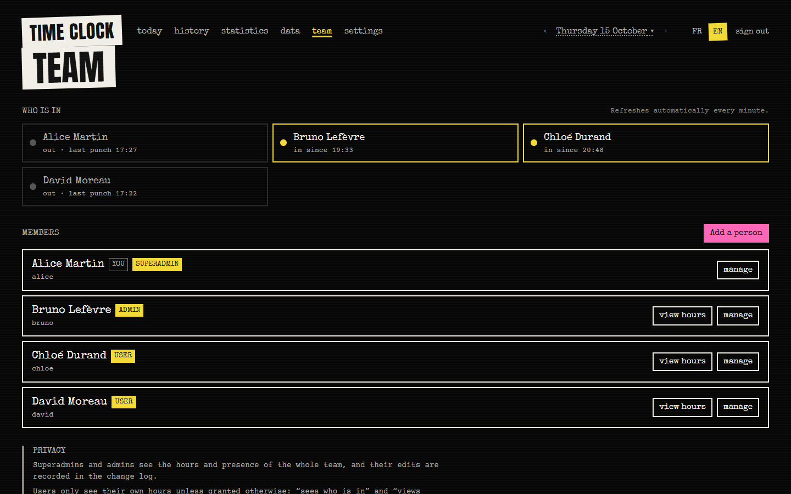
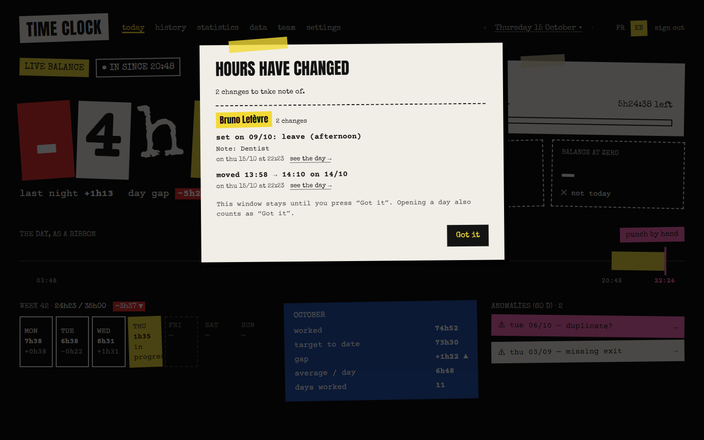

# Opointeuse

[](https://github.com/doooools/Time-clock-Pointeuse/actions/workflows/ci.yml)
[](LICENSE)

*Read in English: [README.md](README.md)*

**Une pointeuse auto-hébergée. Vous passez votre téléphone sur une puce NFC (ou vous appuyez sur un bouton, ou un
lecteur de badge s'en charge) : le pointage est enregistré, l'entrée ou la sortie est déduite toute seule, et
l'application web affiche votre solde d'heures en temps réel.** Elle est pensée pour une personne seule ou une petite
équipe, et tourne sur Cloudflare Workers + D1 (offre gratuite), sur n'importe quel serveur Node, ou dans Docker.






## Fonctionnalités

- **Pointage par webhook** : un appel HTTP par pointage. Compatible Android (Tasker + puce NFC), iPhone (Raccourcis),
  `curl`, Home Assistant ou un lecteur de badge mural. Entrées et sorties alternent automatiquement.
  Voir [docs/integrations/](docs/integrations/README.md).
- **Solde en temps réel** : temps travaillé aujourd'hui, heure de départ prévue, solde cumulé (heures en plus ou en moins).
- **Historique éditable** : ajout, modification et suppression de pointages ; signalement des sorties manquantes et des
  doublons probables ; marquages de journée (congé, maladie, férié, RTT / récupération, jour travaillé, demi-journées).
- **Statistiques** : semaines, mois, heures d'arrivée et de départ, pauses du midi, calendrier en couleurs.
- **Import / export** : collez des horodatages depuis un tableur ; export Excel ou CSV.
- **Multi-comptes et gestion d'équipe** : une personne seule (1 compte) ou une petite entreprise (N comptes) sur la
  même instance. Trois rôles (superadmin, admin, utilisateur) et des droits par compte ; une **page Équipe** pour
  ajouter des personnes, voir **qui est présent** et consulter ou corriger les heures des collègues ; un **journal des
  modifications** de toute correction faite par un tiers, avec des **notifications persistantes** que la personne doit
  acquitter. Une personne seule n'en voit rien. Voir [docs/team.md](docs/team.md) (en anglais).
- **Français et anglais**, au choix de chaque utilisateur.
- **Jours fériés** pour 14 régions (France, Alsace-Moselle, Belgique, Luxembourg, Suisse, Canada, Québec, Allemagne,
  Angleterre et Pays de Galles, États-Unis, Espagne, Italie, Pays-Bas, Portugal), ou aucun. N'importe quel **fuseau
  horaire** IANA.
- **Règles configurables** : objectif quotidien, jours ouvrés, pointages un jour de repos, solde et date de départ.
- **Sécurisée par défaut** : mots de passe PBKDF2, cookies de session signés, verrouillage du compte après des échecs
  de connexion, protection CSRF, Content-Security-Policy stricte, aucun script tiers.

### Règles de calcul en bref

Les pointages d'une journée (dans le fuseau du compte) sont appariés dans l'ordre : 1er–2e, 3e–4e… Un nombre impair de
pointages un jour passé est signalé « sortie manquante » et la dernière entrée compte pour 0. Un jour ouvré sans
pointage ni marquage compte comme un déficit complet et est signalé. Le solde se cumule depuis le premier pointage (ou
depuis une date de départ choisie). Détails : [docs/configuration.md](docs/configuration.md).

## Démarrage rapide

Choisissez une cible. Chacune se termine par la création du premier compte, qui devient **superadmin** (propriétaire), puis vous vous connectez
depuis la page d'accueil. Générez d'abord un secret : `openssl rand -hex 32` (toute chaîne aléatoire de 32 caractères
ou plus convient).

### Node (machine locale ou VPS)

Nécessite Node ≥ 22.13.

```bash
git clone https://github.com/doooools/Time-clock-Pointeuse.git && cd Time-clock-Pointeuse
npm ci
npm run build:node
cp .env.example .env            # puis renseignez SESSION_SECRET dans .env
npm run user -- add alice --generate-password
npm start                       # http://localhost:3000
```

Suite : [docs/deploy-node.md](docs/deploy-node.md) (systemd, Caddy / nginx, sauvegardes).

### Docker

```bash
git clone https://github.com/doooools/Time-clock-Pointeuse.git && cd Time-clock-Pointeuse
echo "SESSION_SECRET=$(openssl rand -hex 32)" > .env
docker compose up -d --build    # http://localhost:3000
docker compose exec opointeuse node dist/server/cli.mjs add alice --generate-password
```

Suite : [docs/deploy-docker.md](docs/deploy-docker.md).

### Cloudflare Workers + D1

```bash
git clone https://github.com/doooools/Time-clock-Pointeuse.git && cd Time-clock-Pointeuse
npm ci
npx wrangler login
npx wrangler d1 create opointeuse        # collez le database_id dans wrangler.jsonc
npm run db:migrate:remote
npx wrangler secret put SESSION_SECRET
npm run deploy
npm run user -- add alice --generate-password --d1-remote
```

Suite : [docs/deploy-cloudflare.md](docs/deploy-cloudflare.md).

### Ensuite

1. Connectez-vous, ouvrez les **Réglages** : choisissez la langue, le fuseau horaire, la région des jours fériés et
   l'objectif quotidien.
2. Copiez votre **URL de webhook** et configurez votre téléphone ou votre lecteur :
   [docs/integrations/](docs/integrations/README.md).
3. Importez éventuellement votre historique depuis la page **Données**.
4. Pour une équipe, ouvrez la page **Équipe** pour ajouter des personnes ([docs/team.md](docs/team.md)).

### Essayer avec des données de démo

Envie de voir l'application remplie avant de pointer pour de vrai ? Créez un compte à part et remplissez-le avec trois
mois de pointages fictifs, des congés et quelques anomalies :

```bash
npm run user -- add demo --generate-password    # Docker : docker compose exec opointeuse node dist/server/cli.mjs …
npm run user -- seed-demo demo                  # Cloudflare : ajoutez --d1-remote aux deux commandes
```

Connectez-vous en tant que `demo`, puis supprimez-le plus tard avec `npm run user -- remove demo --yes`. Détails :
[docs/users.md](docs/users.md).

### Essayer avec une équipe de démo

Pour voir les fonctions d'équipe, `demo-team` crée quatre comptes avec trois mois de données fictives chacun : `alice`
(superadmin), `bruno` (admin), `chloe` (utilisatrice qui voit qui est présent) et `david` (utilisateur qui ne peut pas
modifier ses pointages). Les mots de passe sont affichés une seule fois.

```bash
npm run user -- demo-team       # Docker : docker compose exec opointeuse node dist/server/cli.mjs demo-team
```

Connectez-vous en tant qu'`alice` dans une fenêtre normale et en tant que `chloe` dans une fenêtre privée pour voir les
deux points de vue : chloe a une notification en attente (correction faite « en ligne de commande » sur son dernier
pointage), alice voit la page Équipe et le journal. Supprimez ensuite les quatre comptes avec `remove … --yes`. Détails :
[docs/users.md](docs/users.md#demo-team-options).

## Avec Claude Code

Inutile de suivre les guides à la main. Donnez le lien du dépôt à [Claude Code](https://claude.com/claude-code) avec
vos besoins, et laissez-le faire l'installation et les modifications. Le dépôt contient un `CLAUDE.md` (lu aussi par
les autres agents via `AGENTS.md`) et un skill de mise en place guidée (`.claude/skills/setup/`) : demandez à Claude
Code d'« installer Opointeuse », il pose les quelques questions utiles (cible, équipe, fuseau, fériés, horaires),
puis exécute les étapes en demandant confirmation avant toute action irréversible. Exemples de demandes :

- « Voici le dépôt : `https://github.com/doooools/Time-clock-Pointeuse`. Déploie-le sur mon compte Cloudflare, crée-moi le
  premier compte, fuseau Europe/Paris, jours fériés français. »
- « Installe-le avec Docker sur mon serveur maison derrière Caddy, pour une équipe de 6 personnes, interface en
  français. »
- « Ajoute une région de jours fériés pour le canton de Genève. »
- « Change les couleurs pour un thème bleu nuit. »
- « Je fais des journées de 8 h avec le vendredi après-midi libre : que dois-je configurer ? »

Commencez par [CLAUDE.md](CLAUDE.md), [docs/architecture.md](docs/architecture.md) et
[docs/customization.md](docs/customization.md).

## Documentation

| | |
|---|---|
| [docs/README.md](docs/README.md) | Index de la documentation |
| [docs/deploy-cloudflare.md](docs/deploy-cloudflare.md) · [deploy-node.md](docs/deploy-node.md) · [deploy-docker.md](docs/deploy-docker.md) | Guides de déploiement |
| [docs/configuration.md](docs/configuration.md) | Variables d'environnement, réglages de compte, régions de fériés |
| [docs/team.md](docs/team.md) | Gestion d'équipe : rôles, droits, page Équipe, journal, confidentialité |
| [docs/users.md](docs/users.md) | Gestion des comptes en ligne de commande |
| [docs/api.md](docs/api.md) | Référence de l'API REST |
| [docs/integrations/](docs/integrations/README.md) | Android, iPhone, HTTP, lecteur de badge |
| [docs/architecture.md](docs/architecture.md) · [docs/customization.md](docs/customization.md) | Pour les développeurs et les assistants IA |
| [CONTRIBUTING.md](CONTRIBUTING.md) · [SECURITY.md](SECURITY.md) | Contribuer, signaler une faille |

La documentation détaillée est rédigée en anglais.

## Développement

```bash
npm ci
npm run dev        # Vite + runtime Workers avec une D1 locale (http://localhost:5173)
npm test           # tests unitaires et d'intégration
npm run typecheck
```

Pour `npm run dev`, copiez `.dev.vars.example` en `.dev.vars` et lancez une fois `npm run db:migrate:local`, puis
créez un compte local : `npm run user -- add demo --d1-local --generate-password` (et
`npm run user -- seed-demo demo --d1-local` pour des données de démo).

## Licence

[Apache License 2.0](LICENSE).
