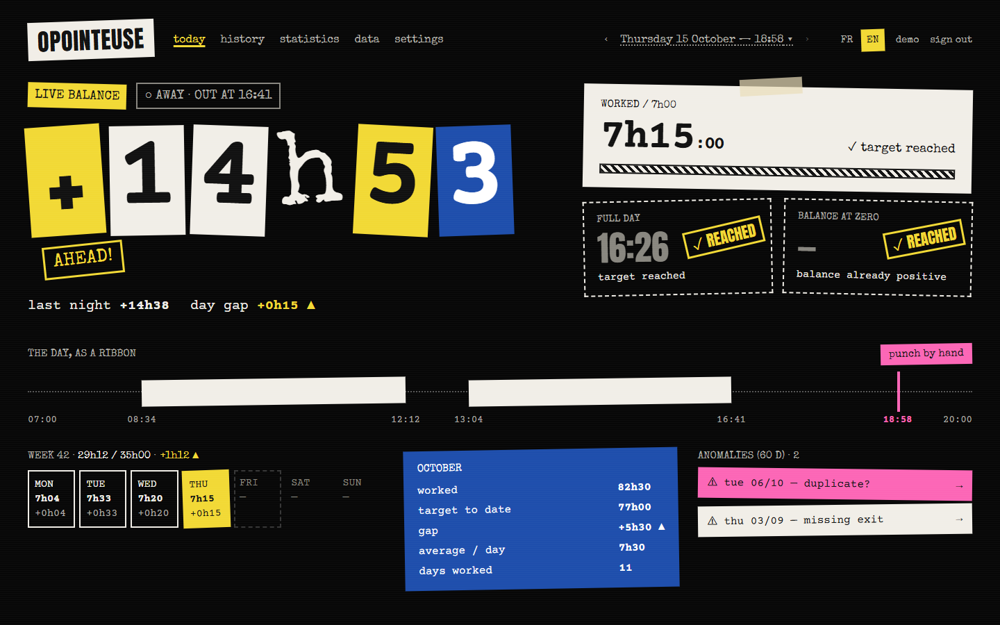
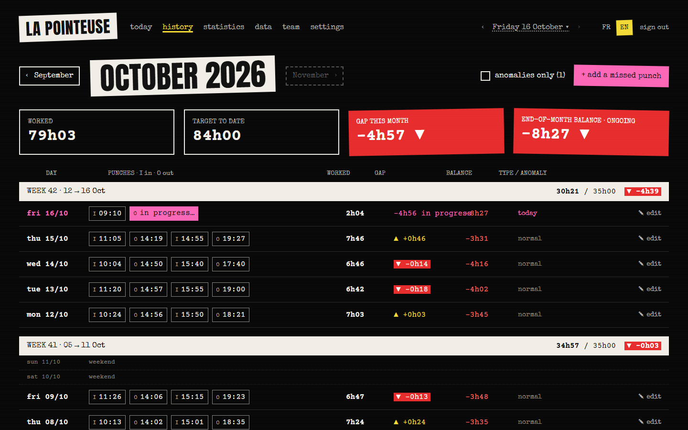
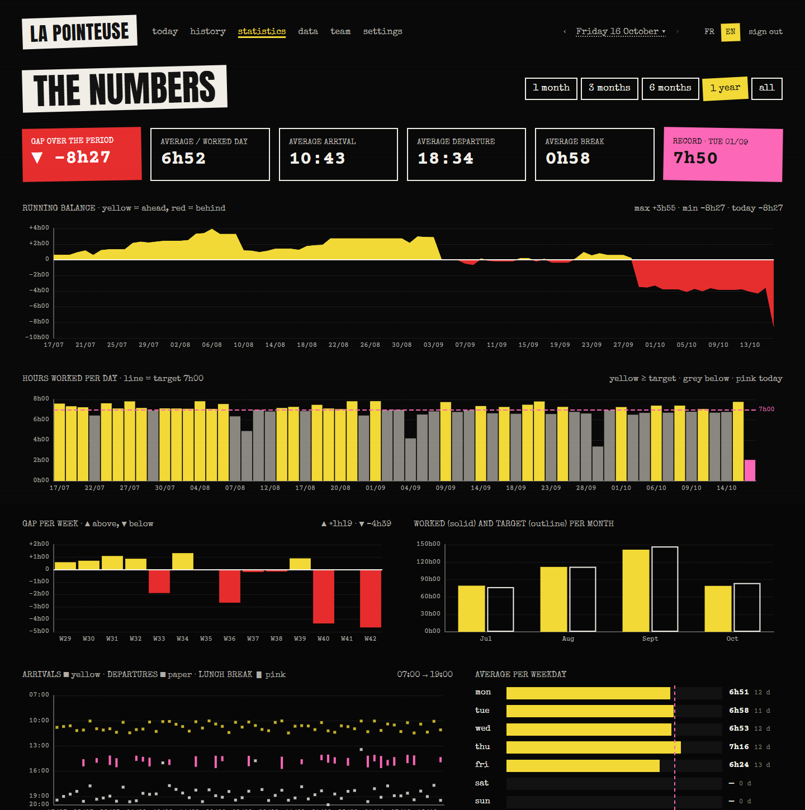
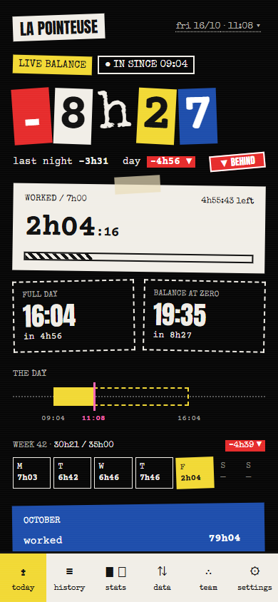

# Opointeuse

[](https://github.com/<owner>/opointeuse/actions/workflows/ci.yml)
[](LICENSE)

*Lire en français : [README.fr.md](README.fr.md)*

**A self-hosted time clock. Tap your phone on an NFC tag (or press a button, or let a badge reader do it): the
punch is recorded, entry or exit is worked out for you, and the web app shows your running overtime balance.**
It is built for one person or a small team, and runs on Cloudflare Workers + D1 (free tier), on any Node server, or
in Docker.






## Features

- **Punch by webhook**: one HTTP call per punch. Works with Android (Tasker + NFC tag), iPhone (Shortcuts), `curl`,
  Home Assistant, or a wall-mounted badge reader. Entry/exit alternate automatically.
  See [docs/integrations/](docs/integrations/README.md).
- **Real-time balance**: time worked today, planned departure time, running balance (overtime / undertime).
- **Editable history**: add, edit and delete punches; flags missing exits and probable duplicates; day marks
  (leave, sick, holiday, comp time, worked day, half days).
- **Stats**: weeks, months, arrival/departure times, lunch breaks, calendar heat map.
- **Import / export**: paste timestamps from a spreadsheet; export to Excel or CSV.
- **Multi-account**: one person (1 account) or a small company (N accounts) on the same instance. Accounts are
  managed from the command line and an admin API (no admin page).
- **French and English**, chosen per user.
- **Public holidays** for 14 regions (France, Alsace-Moselle, Belgium, Luxembourg, Switzerland, Canada, Québec,
  Germany, England & Wales, USA, Spain, Italy, Netherlands, Portugal), or none. Any IANA **time zone**.
- **Configurable rules**: daily target, working days, weekend punches, starting balance and date.
- **Secure by default**: PBKDF2 passwords, signed session cookies, per-account login lockout, CSRF protection,
  strict Content-Security-Policy, no third-party script.

### Calculation rules in short

Punches of a day (in the account's time zone) are paired in order: 1st–2nd, 3rd–4th… An odd number of punches on a
past day is flagged "missing exit" and the last entry counts for 0. A working day without any punch or mark counts
as a full deficit and is flagged. The balance accumulates from the first punch (or from a chosen start date).
Details: [docs/configuration.md](docs/configuration.md).

## Quick start

Pick one target. Each one ends with the first admin account, then you sign in on the home page.
Generate a secret first: `openssl rand -hex 32` (any random string of 32+ characters works).

### Node (local machine or VPS)

Requires Node ≥ 22.13.

```bash
git clone https://github.com/<owner>/opointeuse.git && cd opointeuse
npm ci
npm run build:node
cp .env.example .env            # then set SESSION_SECRET in .env
npm run user -- add alice --admin --generate-password
npm start                       # http://localhost:3000
```

More: [docs/deploy-node.md](docs/deploy-node.md) (systemd, Caddy / nginx, backups).

### Docker

```bash
git clone https://github.com/<owner>/opointeuse.git && cd opointeuse
echo "SESSION_SECRET=$(openssl rand -hex 32)" > .env
docker compose up -d --build    # http://localhost:3000
docker compose exec opointeuse node dist/server/cli.mjs add alice --admin --generate-password
```

More: [docs/deploy-docker.md](docs/deploy-docker.md).

### Cloudflare Workers + D1

```bash
git clone https://github.com/<owner>/opointeuse.git && cd opointeuse
npm ci
npx wrangler login
npx wrangler d1 create opointeuse        # paste the database_id into wrangler.jsonc
npm run db:migrate:remote
npx wrangler secret put SESSION_SECRET
npm run deploy
npm run user -- add alice --admin --generate-password --d1-remote
```

More: [docs/deploy-cloudflare.md](docs/deploy-cloudflare.md).

### Then

1. Sign in, open **Settings**: pick your language, time zone, holiday region and daily target.
2. Copy your **webhook URL** and set up your phone or reader: [docs/integrations/](docs/integrations/README.md).
3. Optionally import your history on the **Data** page.

### Try it with demo data

Want to see a populated app before punching for real? Create a separate account and fill it with three months of
synthetic punches, leave and a few anomalies:

```bash
npm run user -- add demo --generate-password    # Docker: docker compose exec opointeuse node dist/server/cli.mjs …
npm run user -- seed-demo demo                  # Cloudflare: add --d1-remote to both commands
```

Sign in as `demo`, and delete it later with `npm run user -- remove demo --yes`. Details: [docs/users.md](docs/users.md).

## Use it with Claude Code

You do not have to follow the guides by hand. Give the repository link to [Claude Code](https://claude.com/claude-code)
together with what you need, and let it do the set-up and the changes. The repository contains `CLAUDE.md` (also
read by other agents through `AGENTS.md`) and a guided set-up skill (`.claude/skills/setup/`): ask Claude Code to
"set up Opointeuse" and it asks the few questions that matter (target, team, time zone, holidays, hours), then runs
the steps, asking before anything irreversible. Examples:

- "Here is the repo: `https://github.com/<owner>/opointeuse`. Deploy it on my Cloudflare account, create an admin
  account for me, time zone Europe/Brussels, Belgian holidays."
- "Install it with Docker on my home server behind Caddy, for a team of 6 people, French interface."
- "Add a holiday region for the canton of Geneva."
- "Change the colours to a dark blue theme."
- "I need 8-hour days with Friday afternoons off: what should I configure?"

Start with [CLAUDE.md](CLAUDE.md), [docs/architecture.md](docs/architecture.md) and
[docs/customization.md](docs/customization.md).

## Documentation

| | |
|---|---|
| [docs/README.md](docs/README.md) | Index of the documentation |
| [docs/deploy-cloudflare.md](docs/deploy-cloudflare.md) · [deploy-node.md](docs/deploy-node.md) · [deploy-docker.md](docs/deploy-docker.md) | Deployment guides |
| [docs/configuration.md](docs/configuration.md) | Environment variables, account settings, holiday regions |
| [docs/users.md](docs/users.md) | Managing accounts from the command line |
| [docs/api.md](docs/api.md) | REST API reference |
| [docs/integrations/](docs/integrations/README.md) | Android, iPhone, HTTP, badge reader |
| [docs/architecture.md](docs/architecture.md) · [docs/customization.md](docs/customization.md) | For developers and AI assistants |
| [CONTRIBUTING.md](CONTRIBUTING.md) · [SECURITY.md](SECURITY.md) | Contributing, reporting vulnerabilities |

## Development

```bash
npm ci
npm run dev        # Vite + Workers runtime with a local D1 (http://localhost:5173)
npm test           # unit and integration tests
npm run typecheck
```

For `npm run dev`, copy `.dev.vars.example` to `.dev.vars` and run `npm run db:migrate:local` once, then create a
local account: `npm run user -- add demo --admin --d1-local --generate-password` (and
`npm run user -- seed-demo demo --d1-local` for demo data).

## License

[Apache License 2.0](LICENSE).
