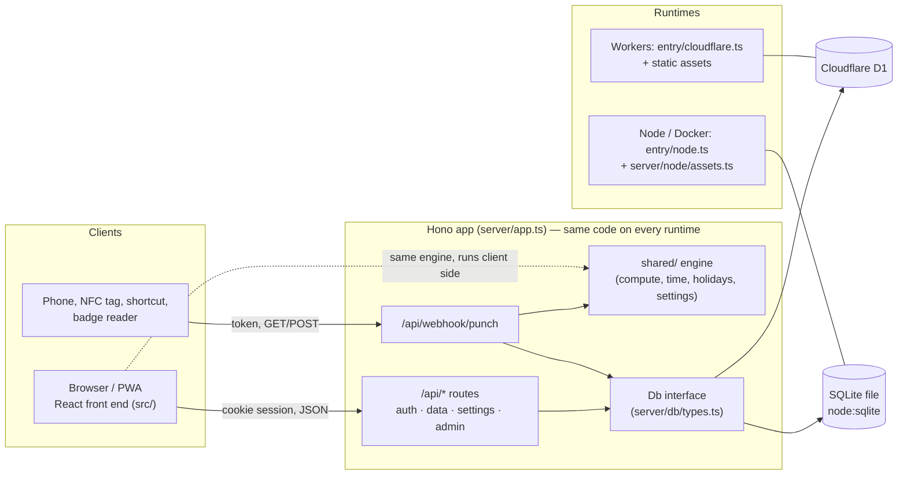
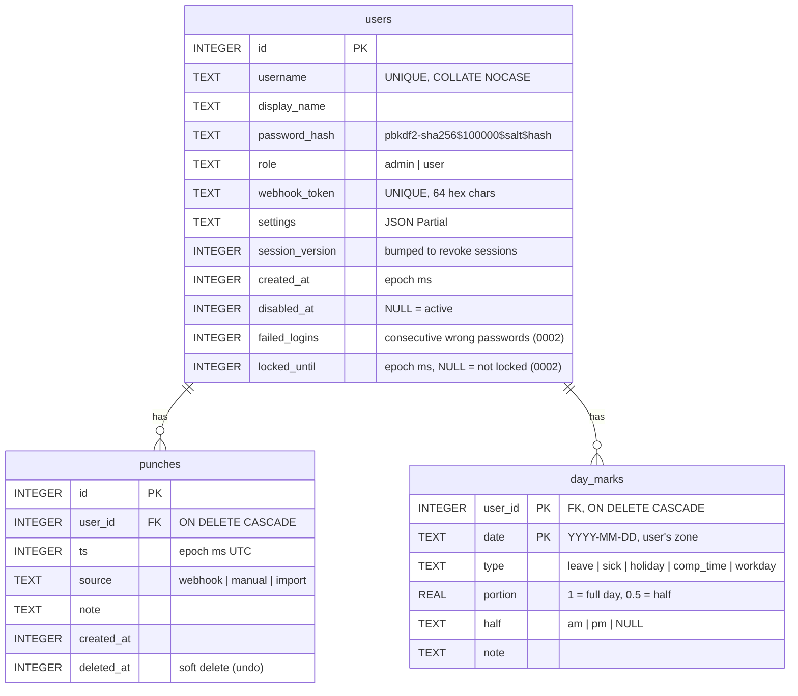

# Architecture

How Opointeuse works and why it is built this way. For step-by-step changes see
[customization.md](customization.md); for the condensed agent view see [../CLAUDE.md](../CLAUDE.md).

## Overview



- **The front end does the computation.** `GET /api/data` returns the raw punches, day marks and the user's
  resolved settings; `src/lib/store.tsx` calls `computeDaysFromGroups()` from `shared/compute.ts` and
  recomputes every minute (live balance). Nothing derived is stored.
- **The server is thin.** It authenticates, validates and stores. The only computation it runs is for the
  webhook reply (worked today, balance, estimated departure), with the same `shared/` functions.
- **One app, two runtimes.** `server/app.ts` only depends on Web APIs (`fetch`, `crypto.subtle`) and on the
  `Env` bindings: `DB` (the `Db` interface) and `ASSETS` (the static front end). Cloudflare provides both
  natively; `server/entry/node.ts` builds them (`createSqliteDb`, `createAssets`).

## Code layout

| Layer | Folder | Depends on |
|---|---|---|
| Engine | `shared/` | nothing (pure TypeScript) |
| API | `server/` (except Node files) | `hono`, `shared/`, `Db`, Web APIs |
| Node runtime | `server/db/sqlite.ts`, `server/migrate.ts`, `server/node/`, `server/entry/node.ts` | `node:*`, `@hono/node-server` |
| Front end | `src/` | React, react-router, ECharts (lazy), xlsx (lazy), `shared/` |
| CLI | `scripts/` | `server/users.ts`, `server/node/database.ts`, wrangler (D1 targets) |

Type-checking mirrors this split: `tsconfig.app.json` (DOM, `src` + `shared`), `tsconfig.worker.json` (Workers
types, `server` + `shared`, Node files excluded), `tsconfig.node.json` (Node types: Node files, configs,
`scripts`). `npm run typecheck` (`tsc -b`) runs all of them.

## Data model

`migrations/0001_init.sql` + `0002_login_throttle.sql` — portable between D1 and SQLite ≥ 3.35.



- A punch is a bare timestamp: whether it is an entry or an exit is **derived** from its position in the day.
  Editing, deleting or inserting a punch re-pairs the day automatically.
- Deleting a punch sets `deleted_at` (the UI offers "undo" → `POST /api/punches/:id/restore`).
- `settings` stores only what the user changed; it is re-sanitized on every read, so removed or invalid keys
  are ignored. No migration is needed to add a setting.
- Migrations are tracked in `d1_migrations` (wrangler's table, reused by `server/migrate.ts` on Node).

## Settings resolution

```
DEFAULT_SETTINGS (shared/settings.ts)
  ← instance defaults: DEFAULT_LOCALE, DEFAULT_TIMEZONE, DEFAULT_HOLIDAYS, DEFAULT_DAILY_TARGET_MIN
    (environment / wrangler vars, via instanceDefaults() + sanitizeSettings)
  ← the account's stored settings (users.settings, via sanitizeSettings)
  = resolved Settings (resolveSettings)
```

| Key | Default | Meaning |
|---|---|---|
| `dailyTargetMin` | 420 | daily target in minutes (0–1440) |
| `workdays` | `[1,2,3,4,5]` | ISO weekdays worked (1 = Monday) |
| `restDayPunchesCount` | `true` | a rest day with punches gets the full target (else all its time is extra) |
| `shortPairMin` | 2 | closed pair shorter than this = probable double punch |
| `timezone` | `"UTC"` | IANA zone used to cut days and show times |
| `holidays` | `"none"` | public-holiday region code (`shared/holidays/`) |
| `balanceStartDate` | `null` | day the balance starts (null = first punch) |
| `initialBalanceMin` | 0 | balance carried over at the start date (signed) |
| `locale` | `"en"` | UI language and language of webhook/server messages |

`PUT /api/settings` with `null` on a key removes it from the account (back to the instance default); an invalid
value is rejected with 400 (nothing saved).

## Computation rules (`shared/compute.ts`)

**Days.** Punches are grouped by local day in `settings.timezone` (`groupByDay`). The computed range runs from
the earliest of (first punch, `balanceStartDate`) to today (or to the last punch if it is in the future), every
calendar day included.

**Pairing.** Within a day, sorted punches are paired in order: 1st–2nd, 3rd–4th… Each pair is an interval.
- An odd last punch **today** is an open interval counted up to now (`present = true`).
- An odd last punch on a **past** day is a `danglingPunch`: it counts for 0 and raises `missing_exit`.
- Intervals never cross midnight: a night shift (22:00 → 02:00) is two dangling punches on two days. Supporting
  it would need a pairing change across days.

**Target** (`targetFor`), in this order:
1. A mark `workday` or `comp_time` → full `dailyTargetMin` (comp time is "paid" by the balance).
2. A mark `leave`, `sick` or `holiday` → `dailyTargetMin × (1 − portion)` (half day = half target).
3. An automatic public holiday of region `settings.holidays` → 0.
4. A rest day (weekday not in `workdays`) → full target if `restDayPunchesCount` and the day has punches, else 0.
5. Otherwise → `dailyTargetMin`. Future days → 0.

`half` (am/pm) is informational only. `delta = worked − target`.

**Anomalies.** `missing_exit` (dangling punch), `short_pair` (closed interval < `shortPairMin` minutes, usually a
double tap), `no_punch` (past day with a target > 0 and no punch, except `comp_time`). Today never gets
`no_punch`.

**Balance.** Starts at `initialBalanceMin` on `balanceStartDate` (or the first punch day) and adds each day's
delta. Earlier days are listed (history, stats) with `inBalance: false` and do not move it. Today's delta is
live (open interval up to now). `todayStatus()` gives yesterday's balance, the live balance, the remaining time,
and the times at which the day target / a zero balance are reached.

**Lunch and departure estimate.** The lunch break is the longest gap between two intervals whose middle falls
between 11:00 and 15:00 local time and lasting 10 min to 4 h (`lunchBreak`). `estimatedDeparture()` adds the
30-day average lunch while lunch has not been taken yet.

**Time zones and DST** (`shared/time.ts`). Everything is epoch ms UTC in storage; conversions use `Intl` with an
explicit `tz`. `zonedToUtc(tz, y, m, d, hh, mm)` resolves an ambiguous local time (clocks going back) to the
first occurrence and a non-existent one (clocks going forward) by shifting it by the gap (02:30 → 03:30). A
DST day therefore has 23 or 25 real hours and intervals are measured in real minutes. Changing a user's
`timezone` re-cuts all past days.

**Public holidays** (`shared/holidays/`). One provider per region returning `[date, local name]` pairs for a
year (Easter-based dates via `easterSunday`), cached per (region, year). 14 regions; `"none"` disables them.
Regional or one-off holidays not covered are entered as `holiday` day marks.

## Authentication and sessions

- **Accounts** are created by the CLI or the admin API; there is no sign-up. Passwords: PBKDF2-SHA256, 100 000
  iterations (the Workers maximum), random salt, `verifyPassword` in constant time (`server/passwords.ts`).
- **Login** (`POST /api/login`): username case-insensitive. Failures (wrong password, unknown or disabled user)
  return the same 401 after ~800 ms, and an unknown user still runs a PBKDF2 check (no user enumeration by timing).
- **Lockout** (migration 0002, `server/users.ts`): before each password check of an existing account (login and
  `POST /api/me/password`), `reserveLoginAttempt` counts the attempt atomically in SQL, so parallel requests cannot
  exceed `LOGIN_MAX_FAILURES` (10) per period; the 10th failure sets `locked_until = now + 15 min`. While locked, the
  password is not even checked: 429 with `Retry-After`, message in the instance language. A correct password calls
  `clearLoginFailures`. The lock is also lifted by a new password (`setPassword`), the admin API (`unlock: true`)
  and the CLI (`unlock`, `enable`, `passwd`). Unknown usernames are never locked; sessions and the webhook are never
  affected.
- **Session cookie** `opointeuse_session` = `<userId>.<sessionVersion>.<exp>.<HMAC-SHA256>` signed with
  `SESSION_SECRET` (≥ 32 chars), httpOnly, `SameSite=Lax`, `Secure` over HTTPS, 90 days. `requireSession`
  verifies the signature and expiry, **reloads the user** and rejects a disabled account or a different
  `session_version`. Changing a password, an admin password reset or disabling an account bumps
  `session_version`, which revokes every existing cookie (the current one is re-issued after a self-service
  password change).
- **Roles**: `user` (own data only) and `admin` (plus `/api/admin/*`). The last active admin cannot be deleted,
  disabled or demoted; the check is inside the SQL statement, so it holds under concurrency.
- **Webhook**: the per-account token (`?token=`, `X-Webhook-Token` or `Authorization: Bearer`) identifies the
  user; no cookie. Regenerating it invalidates the old one.
- Behind a TLS reverse proxy on Node, `entry/node.ts` honours `X-Forwarded-Proto: https` so the cookie keeps
  `Secure`.

## HTTP security (`server/security.ts`)

Mounted in `server/app.ts`, identical on every runtime:

- `securityHeaders` (every response): `nosniff`, `X-Frame-Options: DENY`, `Referrer-Policy: same-origin`,
  `Permissions-Policy`, `Cross-Origin-Opener-Policy`; `/api/*` adds `Cache-Control: no-store` and
  `CSP: default-src 'none'`; front-end files served through `ASSETS` (Node) get `FRONT_CSP` (own scripts only, Google
  Fonts, inline styles for React/ECharts). On Cloudflare the static files bypass the worker
  (`run_worker_first: ["/api/*"]`), so `public/_headers` carries the same front-end headers; a test keeps both equal.
- `csrfGuard` (`/api/*` except the webhook, non-GET): refuses a browser request whose `Sec-Fetch-Site` is not
  `same-origin`/`none` (403), and any body that is not `application/json` (415). Together with `SameSite=Lax` this
  blocks form posts and cross-origin `fetch` (which would need a CORS preflight; the app never answers CORS).
- `apiBodyLimit`: 1 MiB per request on `/api/*` (413), streamed bodies included.
- Not in the app, by design: HSTS (instances may run over plain HTTP on a LAN) and per-IP rate limiting (needs shared
  storage); both belong to the TLS proxy or Cloudflare.

## Internationalisation

- **Front end** (`src/i18n/`): dictionaries per namespace (`common`, `login`, `dashboard`, `history`, `stats`,
  `data`, `settings`, `integrations`). French is the typed reference; each English file is typed
  `Record<keyof typeof fr, string>`, so a missing key fails the build. `t("ns.key", vars)` with `{name}`
  interpolation and `key_one` / `key_other` plurals (`count`). Dates and numbers via `Intl` (`intlTag`).
- **Language choice**: the account's `settings.locale` once signed in (changing it saves the setting); before
  sign-in, the language saved on the device, then `defaultLocale` from `/api/me` (`DEFAULT_LOCALE`), then the
  browser language.
- **Server** (`server/messages.ts`): every error and webhook message in EN and FR, chosen from the user's
  locale (or the instance default before authentication).
- **Shared labels** (`shared/labels.ts`): mark, anomaly and parse-issue labels, used by exports and the server.
- Holiday names stay in the region's language.

## Build and deployment targets

| Target | Build | Runs | Database | Static files |
|---|---|---|---|---|
| Cloudflare Workers | `npm run build` (Vite + `@cloudflare/vite-plugin`) | `wrangler deploy`, entry `server/entry/cloudflare.ts` | D1 `opointeuse` (`wrangler.jsonc`) | Workers assets (`dist/client`, SPA fallback, `/api/*` to the worker first), headers from `public/_headers` |
| Node | `npm run build:node` = `vite build --mode node` (no Cloudflare plugin) + esbuild bundle | `node dist/server/index.mjs` | SQLite file `DATABASE_PATH` (WAL, foreign keys on) | `server/node/assets.ts` (SPA fallback, ETag, 1-year cache on `/assets/*`), headers from `securityHeaders` |
| Docker | same as Node, in a `node:24-slim` build stage | `node:24-alpine`, non-root, `dist/` only | `/data/opointeuse.db` (volume) | same as Node |
| Dev | `npm run dev` (Vite + workerd) | local | local D1 (`.wrangler/`) | Vite |

- The Node bundle inlines every npm dependency and embeds `migrations/*.sql`, so the runtime needs only Node
  ≥ 22.13 and `dist/`. Migrations run at startup. The accounts CLI is bundled as `dist/server/cli.mjs`.
- CI (`.github/workflows/ci.yml`): typecheck, tests, both builds on Node 22 and 24, and `docker build`.

## Decisions and trade-offs

- **Computation client side.** One payload, instant navigation and live updates without polling; the server stays
  simple and cheap (fits the Workers free plan). Cost: the whole history is sent on load (fine for years of
  punches: a few hundred kB), and an admin view of another account must compute in the browser too.
- **Bare punches, derived pairing.** Robust to forgotten or double punches (fix by editing one timestamp), no
  in/out state to get out of sync. Cost: no night shifts across midnight.
- **Webhook tokens stored in clear.** They are shown on the Settings page so the user can configure a phone,
  and they are 256-bit random values looked up by index. A database leak exposes them: regenerate tokens after
  an incident. Passwords are hashed.
- **CSRF protection = `SameSite=Lax` + `Sec-Fetch-Site` + JSON-only bodies**, no CSRF token and no Origin/Host
  comparison (which breaks behind proxies rewriting `Host`). Clients without `Sec-Fetch-Site` (curl, scripts, very old
  browsers) are accepted: they cannot be driven by a malicious page anyway. Mutations are never GET (except the
  webhook, which has its own token and no cookie).
- **Per-account lockout, no per-IP limit.** 10 wrong passwords lock an account's password checks for 15 minutes.
  Trade-off: the 429 reveals that a username exists, and someone who knows it can keep its web login locked
  (sessions, the webhook and admin unlock still work). Per-IP limiting is left to the reverse proxy or a Cloudflare
  rate-limiting rule.
- **Logout only deletes the cookie.** A stolen cookie stays valid until it expires or the password changes (which
  revokes all sessions through `session_version`). A per-device session table would be needed for finer control.
- **Webhook token accepted in the query string** for the simplest clients (NFC/Tasker, badge readers), although
  headers are recommended: URLs end up in logs.
- **`node:sqlite`, no native module.** Same code path everywhere, trivial Docker image. One Node process per
  database file (no multi-instance locking beyond `busy_timeout`).
- **Settings as JSON per account** rather than columns: adding a setting needs no migration; validation lives in
  one place (`sanitizeSettings`).
- **No admin UI** (yet): the admin API is complete and tested; accounts are usually managed once, from the CLI.
